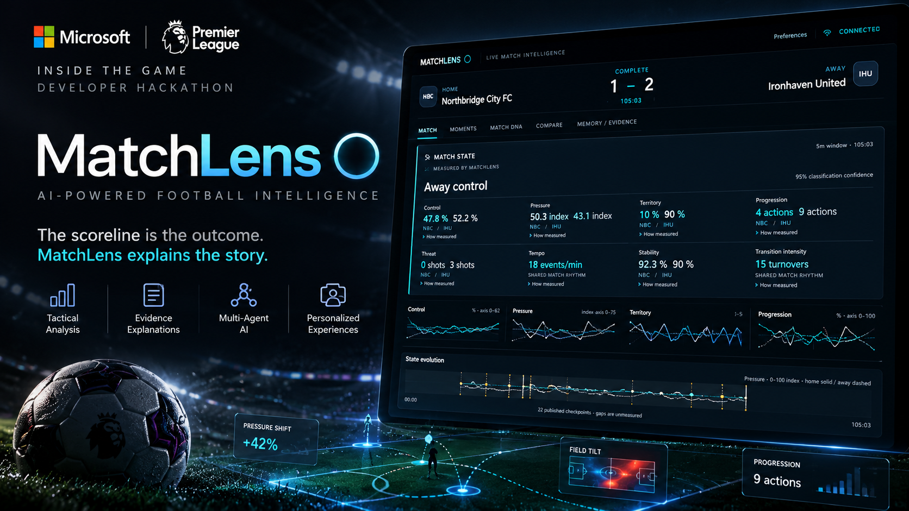
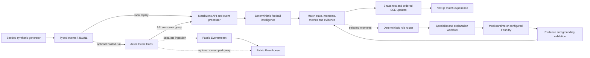

# MatchLens

MatchLens turns **synthetic football match events** into measured match state, evidence-linked explanations, and an interactive viewing experience. It was built for Microsoft's *Inside the Game: Developer Hackathon*, in collaboration with the Premier League.

## 🎬 Watch the 1:59 MatchLens Demo

**[▶ Watch the full hackathon demo on Vimeo](https://vimeo.com/1238417597?share=copy&fl=sv&fe=ci)**

See the local match replay, the evidence behind the 21:14 goal, and the Story Stress Test compare observed and omitted tactical readings. The recording uses synthetic match data and offline mock interpretation.

[](https://vimeo.com/1238417597?share=copy&fl=sv&fe=ci)

*Click the preview to watch the demo on Vimeo.*

Try the [Main Demo](https://matchlens-web.ashystone-436ed578.koreacentral.azurecontainerapps.io/demo) or the [Streaming Experience](https://matchlens-web.ashystone-436ed578.koreacentral.azurecontainerapps.io/stream). The main demo explores a recorded synthetic match. The streaming page reports whether its optional Event Hubs path is enabled and, when enabled, offers an on-demand synthetic run.

MatchLens uses deterministic Python analysis, a FastAPI service, a Next.js interface, optional Microsoft Agent Framework and Foundry workflows, Azure Event Hubs, and a separate Microsoft Fabric ingestion path. It does not use official Premier League match data and is not an official Premier League or Microsoft product.

## Why MatchLens

A match produces more events than a viewer can interpret one by one. A scoreline and a set of totals do not show when pressure changed, which evidence supports a tactical reading, or how an explanation should differ for a fan, analyst, broadcaster, or player.

MatchLens keeps calculation and interpretation separate. Its simulator creates reproducible, football-shaped events. Deterministic code calculates statistics, tactical states, moments, and evidence references. Optional agent workflows can select and explain supported claims; application validators check their citations and structure before the result is shown. The interface lets a reviewer move from a match-level claim to its measurements and source events.

## What the system does

- **Generates reproducible matches.** Seeded simulation produces typed event records and match metadata. The checked-in seed-99 match is also used by the recorded demo and streaming workflow.
- **Calculates match state.** The intelligence engine derives possession sequences, team and player statistics, rolling windows, tactical classifications, transitions, and significant moments from the event record.
- **Makes claims inspectable.** Explanations reference evidence and source events. Deterministic validators check IDs, timestamps, metrics, and links rather than accepting unsupported prose because it contains a plausible number.
- **Presents the match in context.** The frontend combines score and statistics with a timeline, State Ribbon, Match DNA checkpoints, source inspection, and fan, analyst, broadcast, and player views.
- **Tests a specific interpretation.** Story Stress Test removes an observed possession sequence from a fixed-window calculation and compares the tactical classification. It holds later events fixed; it does not resimulate the match, recalculate the score, or make a causal prediction.
- **Supports routed agent workflows.** A deterministic policy chooses relevant Tactical, Player, and Context roles. The workflow consolidates findings, constructs an evidence-grounded explanation, validates it, and then prepares a narrative. The runtime can be mock or Microsoft Foundry, depending on configuration.
- **Supports an optional streaming path.** A hosted run can publish a synthetic replay through Event Hubs, consume it back through the API's normal processing pipeline, and report run-scoped reconciliation. A separately configured Fabric path can ingest the same envelopes through Eventstream into Eventhouse.

## Architecture

The replay/SSE experience, the optional model workflow, and the Event Hubs/Fabric transport are related but distinct paths. Foundry is not an Event Hubs component and does not calculate match statistics.



The local path replays events into the same processing and projection code without requiring cloud services. In the hosted streaming mode, the API publishes a generated replay, consumes the envelopes using its configured consumer group, and feeds accepted events through the MatchLens processor. Fabric consumes independently. Application-side Fabric topology and destination checks are optional configuration; otherwise Fabric verification is performed separately by an operator.

## One completed integration run

The following figures describe **one recorded synthetic run**, not a guarantee for every deployment or future run:

- The run contained 1,728 expected events. The publisher reported 1,728 published and acknowledged.
- Event Hubs readback found 1,728 events; the API received and processed 1,728, with zero reported processing errors. Those checks reported no missing, duplicate, unexpected, or altered events.
- A separate read-only Fabric KQL check found 1,728 unique event IDs and 1,728 unique sequence numbers, spanning 0 through 1,727.
- The completed run was displayed in the deployed frontend after a frontend proxy fix.

For this run, streaming interpretation used the mock runtime. The application's automatic Fabric verification setting was disabled; Fabric was checked separately with read-only queries. This is evidence for that run, not for continuous ingestion, horizontal scaling, or recovery after arbitrary container failures.

Microsoft Foundry integration is implemented, and a real inference was previously verified in the main experience. The public deployment's current Foundry availability depends on its runtime configuration and identity; the README does not imply that every session uses Foundry. MatchLens reports execution status with each workflow result. Mock execution and a Foundry-enabled configuration are not interchangeable evidence.

## Live experiences

| Route | What it demonstrates |
| --- | --- |
| [Main Demo](https://matchlens-web.ashystone-436ed578.koreacentral.azurecontainerapps.io/demo) | Recorded synthetic match replay, state and timeline views, moments, evidence inspection, audience modes, and Story Stress Test. |
| [Streaming Experience](https://matchlens-web.ashystone-436ed578.koreacentral.azurecontainerapps.io/stream) | Streaming status and, when the deployment enables it, a button to start an on-demand synthetic Event Hubs run with per-stage counts and reconciliation state. If streaming is disabled, the page directs visitors to the recorded replay. |

Streaming availability and cloud integrations are deployment settings; the source repository alone cannot establish their current live status. The streaming page does not represent an always-on feed of new matches.

## How a match moves through MatchLens

1. The seeded simulator generates typed match events, or the application loads the checked-in synthetic match.
2. In the transport path, each event is wrapped in an `EventEnvelope` with a schema version, match and event IDs, a sequence number, simulation timestamp, and correlation ID.
3. Local replay sends events directly into the processing pipeline. The optional hosted path publishes them to Event Hubs using bounded batches and retry/backoff settings.
4. The API consumer validates envelopes and payloads, ignores exact duplicates, rejects conflicting identities, and rejects late events whose timestamp/sequence pair precedes the last accepted event.
5. Shared deterministic analysis derives rolling statistics, tactical state, transitions, significant moments, and traceable evidence.
6. For selected moments, the deterministic router may start the optional agent workflow. Retrieved evidence is checked by application-side grounding validators before an explanation or narrative is accepted.
7. The API serves snapshots and sends ordered SSE updates to the frontend. The client applies updates by sequence number and can recover from a reset with a fresh snapshot.
8. In the separate data path, Fabric Eventstream ingests Event Hubs envelopes into Eventhouse. If configured, a run-scoped query can reconcile the destination against the published run; otherwise an operator can verify it separately.

The local experience and hosted streaming run are initiated on demand. Neither implies a continuously operating match-ingestion service.

## Technology

| Area | Technology | Role |
| --- | --- | --- |
| Frontend | Next.js, React, TypeScript, Tailwind CSS | Match views, replay controls, SSE updates, evidence inspection, and streaming status. |
| API | Python 3.12, FastAPI, Uvicorn, Pydantic | HTTP endpoints, session handling, event processing, snapshots, and SSE. |
| Match simulation | Python, Pydantic | Seeded team/player generation and typed synthetic events. |
| Intelligence | Python | Deterministic statistics, rolling analysis, tactical classification, moments, and explainability. |
| Agent workflows | Microsoft Agent Framework; optional Azure AI Foundry client and Azure Identity | Routed specialist, explanation, validation, and narrative workflow. |
| Messaging | Azure Event Hubs SDK | Optional event publishing and consumption for hosted synthetic runs. |
| Analytics destination | Microsoft Fabric Eventstream, Eventhouse, and KQL | Separate ingestion and optional run-scoped verification. |
| Packaging and checks | Docker, Docker Compose, pytest, Vitest, TypeScript, GitHub Actions | Local/container packaging and offline regression checks. |

## Repository map

```text
simulator/
  generation/          seeded synthetic match and participant generation
  models/              typed match and event schemas
  engine/               event simulation and match mechanics
  intelligence/         deterministic metrics, states, moments, explanations
  agentic/              routing, tools, grounding, runtimes, and workflows
  realtime/             event envelopes, Event Hubs transport, processing
  presentation/         local match API, replay service, snapshots, SSE
  production/            public sessions, hosted streaming, config, reconciliation
frontend/
  app/                  Next.js routes
  components/           match, timeline, evidence, and stream interfaces
  lib/                  API clients, schemas, state projection, stream status
deploy/                  safe environment templates and deployment guides
docs/                    event envelope schema and Fabric notes
tests/                   Python offline and opt-in integration tests
```

## Local development

### Prerequisites

- Python 3.12 or newer (the project and CI use Python 3.12).
- Node.js 24 and npm.
- Docker only if you want the containerized path.

### Install and run the offline demo

```sh
git clone https://github.com/AyushkhatiDev/MATCHLENS.git
cd MATCHLENS
python3.12 -m venv .venv
source .venv/bin/activate
python -m pip install -e '.[agentic,realtime,presentation,dev]'
npm --prefix frontend ci
./start.sh --mock
```

Open [http://127.0.0.1:3002/demo](http://127.0.0.1:3002/demo). The launcher starts the API on port 8002 and the frontend on port 3002; press Ctrl+C in that terminal to stop the processes it started. Ports can be changed together:

```sh
./start.sh --mock --backend-port 8003 --frontend-port 3003
```

The offline profile uses local replay and mock agents. It does not need Azure credentials. `start.sh` requires the project `.venv` and installed frontend dependencies. Without `--mock`, the launcher selects the Foundry demo profile and may make real, billable model requests once a workflow runs. Use that mode only with a valid existing project/deployment and an authorized Azure identity.

To generate and analyze another deterministic synthetic match without starting the web application:

```sh
python -m simulator.run --seed 42 --duration 90 \
  --output data/generated/demo/match.jsonl --analyze --explain
```

Generated output is local and ignored by Git. To build and run the local containers instead, use:

```sh
docker compose -f deploy/compose.yaml up --build
```

Then open [http://127.0.0.1:3001/demo](http://127.0.0.1:3001/demo). The Compose profile uses mock agents and local match input.

### Optional Foundry workflow

The launcher reads the tracked `deploy/foundry-demo.env.example` template and, when present, the Git-ignored `deploy/foundry-demo.env` local file. Copy the template, then set the existing Foundry project endpoint and deployed model name in the local file:

```sh
test -e deploy/foundry-demo.env || cp deploy/foundry-demo.env.example deploy/foundry-demo.env
```

Exported shell variables override values from the local file. The launcher selects Foundry mode, local replay, and the ports for the local demo. Missing or invalid endpoint/model settings fail before server startup. Authentication uses `DefaultAzureCredential`; do not add credentials to the template or commit the local file. This mode can incur model costs.

## Configuration

Use the tracked example templates as references. Real credentials and resource-specific values belong in local ignored files or the deployment's secret/configuration store, never in Git.

| Variable(s) | Scope and requirement | Purpose |
| --- | --- | --- |
| `AGENTIC_MODE` | Server; optional, defaults to mock | Selects `mock` or `foundry`. The local `--mock` launcher selects mock. |
| `FOUNDRY_PROJECT_ENDPOINT`, `FOUNDRY_MODEL` | Server; required in Foundry mode | Foundry project endpoint and existing deployed model. Leave `FOUNDRY_AGENT_ID` unset; agents are code-defined. |
| `AZURE_CLIENT_ID` | Server; optional | Selects a user-assigned managed identity for Azure Identity. Foundry authentication uses `DefaultAzureCredential`. |
| `APP_ENV`, `APP_FRONTEND_ORIGINS`, `APP_DEMO_CONTROLS`, `APP_AUTOSTART`, `APP_DIAGNOSTICS` | Server; launcher supplies local values, deployment values are profile-specific | Application policy, allowed browser origin, replay controls, consumer startup, and diagnostics. A deployed public demo needs its allowed HTTPS frontend origin. |
| `EVENT_SOURCE` | Server; optional, defaults to local | Selects local replay or Event Hubs input. |
| `AZURE_EVENT_HUB_FULLY_QUALIFIED_NAMESPACE`, `AZURE_EVENT_HUB_NAME`, `AZURE_EVENT_HUB_CONSUMER_GROUP` | Server; required when the corresponding Event Hubs consumer/stream is enabled | Names the namespace, hub, and consumer group. Hosted streaming requires a dedicated API consumer group and managed identity; prefer Azure Identity over a connection string. |
| `APP_STREAMING`, `APP_STREAM_SPEED`, `APP_STREAM_AGENT_MODE`, `APP_STREAM_FABRIC_VERIFY` | Server; optional, streaming defaults off and stream runtime defaults to mock | Enables hosted streaming, sets replay speed/runtime, and opts into automatic Fabric verification. |
| `FABRIC_WORKSPACE_ID`, `FABRIC_EVENTSTREAM_ID`, `FABRIC_EVENTHOUSE_ID`, `FABRIC_KQL_ENDPOINT`, `FABRIC_KQL_DATABASE` | Server; needed only for configured Fabric checks | Identifies Fabric items and query endpoint. Supply values from the target workspace; do not copy private identifiers into documentation. |
| `NEXT_PUBLIC_API_BASE_URL`, `NEXT_PUBLIC_DEMO_SESSIONS` | Frontend; optional defaults, local launcher supplies its API URL/session mode | Selects the browser API base and public-demo session behavior at dev/build time. A safe local API example is `http://127.0.0.1:8002`. |
| `MATCHLENS_API_ORIGIN` | Frontend build; optional unless the production API proxy is used | Sets the API proxy target as a bare HTTPS origin, for example `https://api.example.com`. |

Additional retry, timeout, queue, stream-budget, and SSE settings are documented in [deploy/public-demo.md](deploy/public-demo.md), [deploy/azure.md](deploy/azure.md), and the safe templates under [deploy/](deploy/). The templates contain placeholders, not deployable credentials.

## Tests and checks

Run the offline Python suite from the repository root:

```sh
python -m pytest -q
```

Run frontend tests, TypeScript validation, and a production frontend build:

```sh
npm --prefix frontend ci
npm --prefix frontend run test
npm --prefix frontend run typecheck
npm --prefix frontend run build
```

The GitHub Actions offline workflow also generates deterministic agent inputs, runs the Python and frontend checks, evaluates the offline workflow, checks dependency licenses and security signatures, and builds the Compose images. Tests for live Foundry, Event Hubs, Fabric, and cloud end-to-end behavior are opt-in; an offline pass does not establish current cloud connectivity.

The test suite covers deterministic simulation, event/schema validation, presentation routes and SSE, explanation grounding, Story Stress Test, workflow contracts, retry and duplicate handling, transport reconciliation, and public-session behavior. See [tests/](tests/) and [frontend/tests/](frontend/tests/) for the test cases. CI results apply to the commit and environment that ran them; no current test count is asserted here.

## Current boundaries and follow-up

- Inputs are synthetic. MatchLens does not ingest official Premier League match feeds.
- Deterministic calculations are the source for measured statistics. Agent output is an interpretation constrained by retrieved evidence, not independent verification of football truth.
- Story Stress Test is a fixed-cutoff sensitivity comparison, not a counterfactual match simulation or causal claim.
- Event Hubs streaming is an optional, user-started synthetic run. Runtime and Fabric status depend on deployment configuration.
- Public demo sessions and replay state are held in process memory. The project does not claim durable session recovery, indefinite streaming, horizontal scaling, or production availability guarantees.
- Live Foundry execution and automatic Fabric reconciliation are configuration-dependent; neither is guaranteed by the local mock workflow or a single historical run.

Potential follow-up includes durable run/session state, longer-duration operational monitoring, and deployment-specific acceptance runs that verify Foundry, Event Hubs, and Fabric together when those paths are enabled.

## Contributing, license, and data

Focused contributions are welcome. Please keep synthetic fixtures reproducible, run the relevant offline checks, and describe the behavior and verification scope in a pull request. Do not include credentials, private run receipts, or cloud account/resource identifiers.

The repository is distributed under the existing [MIT License](LICENSE). Third-party notices are in [THIRD_PARTY_NOTICES.txt](THIRD_PARTY_NOTICES.txt). Synthetic fixtures are generated for this project and are not official Premier League data. No rights to real match feeds, marks, footage, or other third-party competition data are claimed.
