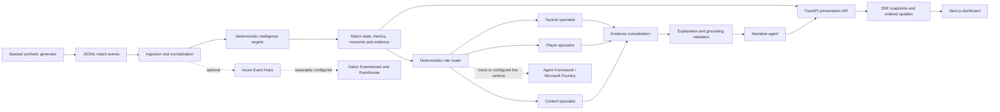

# MatchLens

**The Scoreline Is the Outcome. MatchLens Explains the Story.**

MatchLens is a synthetic football simulator and explainable football intelligence engine. Deterministic analytics calculate match states and evidence from generated events; optional agent workflows interpret selected moments, with application-side checks tying claims back to those events.

> Deterministic systems calculate the truth. Agents interpret the truth. MatchLens proves the interpretation.

MatchLens is an independent project built in a Microsoft-focused hackathon context. It is not affiliated with or endorsed by Microsoft or the Premier League. Match inputs are synthetic and do not represent official competition data.

## The problem and approach

A score and a box of statistics tell you what happened. They do not necessarily explain how control shifted, where pressure built, or which recorded actions support a tactical reading. MatchLens separates those tasks. The simulator creates the event record; deterministic code calculates metrics, states, moments and evidence; agents can interpret selected moments; validators reject unsupported claims. Calculated facts, model interpretations and sensitivity analysis remain distinct in the API and interface.

## What is implemented

- Seeded synthetic match generation and event replay, with JSONL inputs and match metadata.
- Deterministic possession, pressure, progression, territory and threat analysis, rolling windows, tactical state classification, transitions and significant moments.
- An API that publishes match snapshots, moments, evidence and source events, plus ordered updates over Server-Sent Events (SSE).
- Optional Microsoft Agent Framework workflows with five code-defined roles: **Tactical**, **Player**, **Context**, **Explanation** and **Narrative**. A deterministic router selects specialist roles. Tactical, player and context analysis can run in parallel; application code consolidates findings, constructs the explanation, validates its grounding, then allows the narrative stage to run.
- Evidence references and source-event navigation so a reviewer can inspect which synthetic records support a claim.
- Match timeline, score, statistics, Match DNA checkpoints and player-focused analysis, with fan, analyst, broadcast and player presentation modes.
- **Story Stress Test**, a sensitivity analysis at a fixed published checkpoint. It omits an observed possession sequence from the selected calculation, keeps later events fixed, compares the supported tactical classification, then restores the original view. It does not resimulate the match, recalculate the score, or predict what would have happened.
- Optional Azure Event Hubs ingestion and a separate Microsoft Fabric Eventstream/Eventhouse path. These are integrations with their own configuration and verification; they do not participate in every local run.

## Architecture



The simulator and intelligence engine own the event record and calculated football metrics. The presentation service owns the loaded match, replay lifecycle and published checkpoints. The agent router applies product policy rather than asking a model which specialists to call. Role-scoped tools expose timestamp-bounded evidence; the validator checks the resulting structured claims against retrieved evidence and deterministic context. The FastAPI layer exposes that state and streams updates; the Next.js client applies ordered updates and renders sourceable claims. Event Hubs and Fabric are optional external paths. Foundry is an optional model runtime for the agent workflow, not the calculator for match statistics.

## Technology

| Area | Technologies |
| --- | --- |
| User interface | Next.js, React, TypeScript, Tailwind CSS, Vitest |
| API and models | Python 3.12, FastAPI, Uvicorn, Pydantic |
| Simulator and analytics | Python; seeded generation, event processing and deterministic rolling-window analysis |
| Agent workflows | Microsoft Agent Framework; optional Azure AI Foundry project and model deployment |
| Streaming and messaging | Server-Sent Events locally; optional Azure Event Hubs |
| Analytical integration | Optional Microsoft Fabric Eventstream and Eventhouse/KQL |
| Verification and packaging | pytest, npm lockfile, Docker, Docker Compose, GitHub Actions |

## Verification record and limits

The repository contains historical local verification notes from **5–8 October 2026**. These are dated records, not tests rerun for this publication. The supplied Phase 11 report records a deterministic 1,728-event replay, 56 moments, 12 completed mock workflows and a final score of 1–2; it also records eight Match DNA dimensions and two Story Stress Test outcomes, with the canonical snapshot unchanged after restoration. The associated local report says events arrived in order over SSE and the final state matched the backend snapshot. These results describe that recorded local run, not every environment.

A separate historical Foundry report records a genuine workflow with specialist support, grounding and arbitration checks, plus a rejected result when the grounding contract failed. This is evidence for those individual executions, not a reliability or model-quality guarantee. Offline tests for a temporary cost-control transport guard also passed, but that guard is not wired into production application clients; production-wide request, token or cost enforcement is not claimed.

Historical Event Hubs transport checks and a separate authenticated Fabric browser/KQL check are documented in local audit materials. They were not a single combined live Event Hubs → Fabric → Foundry run. Private execution receipts, run identifiers, cloud resource IDs, screenshots and phase reports are intentionally excluded from the public source set. A checkout therefore cannot reproduce or independently validate those historical cloud runs. No current public application deployment is claimed.

Material boundaries:

- Match data is synthetic; it is not official Premier League data.
- Model interpretations depend on available events and retrieved evidence. A successful workflow does not establish independent football truth.
- Story Stress Test compares a defined input omission at a fixed cutoff; it is not causal analysis or a forecast.
- Mock and Foundry workflows are different runtime modes. Mock success does not prove Foundry availability or output quality.
- Azure integrations need their own resources, credentials and current integration tests.
- The app keeps replay/session state in process memory; it is a local demo and engineering project, not a production-deployment claim.
- The offline Foundry audit guard is temporary tooling and does not automatically constrain production clients.

## Getting started

### Prerequisites

- Python **3.12**.
- Node.js **24** and npm.
- macOS, Linux or another environment capable of running the Python and Node dependencies. Docker is optional.

### Install and start the offline demo

```sh
git clone https://github.com/AyushkhatiDev/MATCHLENS.git
cd MATCHLENS
python3.12 -m venv .venv
source .venv/bin/activate
python -m pip install -e '.[agentic,realtime,presentation,dev]'
cd frontend
npm ci
cd ..
./start.sh --mock
```

Open [http://127.0.0.1:3002/demo](http://127.0.0.1:3002/demo). The one-command launcher starts the API on port 8002 and the frontend on port 3002; Ctrl+C stops the two processes it started. Use the port options when those ports are already occupied:

```sh
./start.sh --mock --backend-port 8003 --frontend-port 3003
```

The mock path uses the checked-in synthetic seed99 input, local event processing and mock agent runtime. It requires no Azure login or `.env` file. The launch script reads the non-secret `deploy/demo.env.example`; its defaults can be overridden with shell environment variables.

To generate and analyze another deterministic synthetic match without starting the dashboard:

```sh
python -m simulator.run --seed 42 --duration 90 --output data/generated/demo/match.jsonl --analyze --explain
```

Generated output is local and ignored by Git. For a containerized local run, use `docker compose -f deploy/compose.yaml up --build` and open [http://127.0.0.1:3001/demo](http://127.0.0.1:3001/demo). Docker and its image builds are optional for the Python/Node development path.

### Optional live Foundry workflow

The launcher defaults to the Foundry hero demo when `--mock` is omitted. That mode can make real model-inference requests. Configure a valid project and deployed model and authenticate with an authorized Azure identity before using it. Do not run it merely to test the offline setup.

```sh
test -e deploy/foundry-demo.env || cp deploy/foundry-demo.env.example deploy/foundry-demo.env
```

Set `FOUNDRY_PROJECT_ENDPOINT` and `FOUNDRY_MODEL` in `deploy/foundry-demo.env` to the existing authorized project and deployment. This local file is ignored by Git and is loaded only by `./start.sh` in its default Foundry mode. The checked-in example remains a placeholder template. Precedence is example defaults, then the local Foundry file, then exported process variables; the launcher applies its required Foundry mode, local replay, demo controls and selected frontend/API URLs last. Missing or invalid settings fail before either server starts, without displaying values. Authentication continues to use the existing Azure identity through `DefaultAzureCredential`. Foundry availability, permissions, quota and cost depend on your Azure account.

### Public deployment

To publish the browser demo (Vercel frontend, Azure Container Apps API, mock mode by default), follow [deploy/public-demo.md](deploy/public-demo.md).

## Configuration reference

Examples are templates only. `.env` files are not automatically loaded by Python; `./start.sh` reads its selected `deploy/*.env.example` profile and overlays the current process environment. `frontend/.env.example` documents the browser-side defaults; Next.js reads its `NEXT_PUBLIC_` settings at dev-server start or build time.

| Variable | Purpose | Required scope / example |
| --- | --- | --- |
| `AGENTIC_MODE` | `mock` or `foundry` runtime | Defaults to `mock`; Foundry needs endpoint and model |
| `FOUNDRY_PROJECT_ENDPOINT` | Foundry project HTTPS endpoint | Foundry only; `https://your-resource.services.ai.azure.com/api/projects/your-project` |
| `FOUNDRY_MODEL` | Existing deployed model name | Foundry only; set to your deployment name |
| `FOUNDRY_AGENT_ID` | Service-managed agent identifier | Leave unset; this project uses code-defined agents |
| `AGENTIC_TIMEOUT_SECONDS` | Per-workflow call timeout | Optional; default 60 seconds |
| `AZURE_CLIENT_ID`, `AZURE_TENANT_ID`, `AZURE_SUBSCRIPTION_ID` | Optional Azure identity selection | Azure identity configuration only; do not put client secrets here |
| `APP_ENV` | `local`, `demo`, `staging` or `azure` policy | Defaults to `local` |
| `APP_FRONTEND_ORIGINS` | Allowed browser origins | Local default is `http://127.0.0.1:3000,http://localhost:3000`; launcher sets its selected port |
| `APP_DEMO_CONTROLS` | Enable local replay controls | Defaults on locally/demo; keep off in cloud environments |
| `APP_AUTOSTART` | Start an Event Hubs consumer on startup | Optional; defaults according to event source |
| `APP_FOUNDRY_HERO_ONLY` | Restrict Foundry workflow to the guided demo moment | Optional; launcher selects it for Foundry demo mode |
| `APP_DIAGNOSTICS`, `APP_MAX_SSE_SUBSCRIBERS`, `APP_SSE_SECONDS` | Local diagnostics and SSE bounds | Optional; diagnostics default on locally and off in cloud policy |
| `EVENT_SOURCE` | `local` or `eventhub` input | Defaults to `local` |
| `AZURE_EVENT_HUB_FULLY_QUALIFIED_NAMESPACE`, `AZURE_EVENT_HUB_NAME`, `AZURE_EVENT_HUB_CONSUMER_GROUP` | Event Hubs consumer target | Event Hubs only; use your namespace, hub and dedicated consumer group |
| `AZURE_EVENT_HUB_CONNECTION_STRING` | Explicit credential-bearing fallback | Optional; prefer Azure Identity. Never commit a real connection string |
| `REALTIME_QUEUE_SIZE`, `REALTIME_MAX_ATTEMPTS`, `REALTIME_BACKOFF_SECONDS`, `REALTIME_RECEIVE_TIMEOUT_SECONDS`, `REALTIME_BATCH_SIZE`, `REALTIME_FLUSH_SECONDS`, `REALTIME_PUBLISH_TIMEOUT_SECONDS` | Bounded Event Hubs queue, retry and batch behavior | Optional; defaults are in `simulator/production/config.py` and `simulator/realtime/azure.py` |
| `FABRIC_WORKSPACE_ID`, `FABRIC_EVENTSTREAM_ID`, `FABRIC_EVENTHOUSE_ID`, `FABRIC_KQL_ENDPOINT`, `FABRIC_KQL_DATABASE` | Existing Fabric items and KQL query endpoint | Fabric integration only; IDs and endpoint are deployment-specific, never copied into this template |
| `MATCHLENS_DEMO_PATH` | Synthetic JSONL match loaded by the presentation API | Optional; defaults to the checked-in seed99 fixture |
| `APP_PUBLIC_DEMO` | Select the isolated public demo-session API | Internal launcher setting; do not expose configuration casually |
| `NEXT_PUBLIC_API_BASE_URL`, `NEXT_PUBLIC_DEMO_SESSIONS` | Browser API endpoint and session mode | Frontend; local launcher sets these for its chosen ports |
| `MATCHLENS_RUN_FOUNDRY_TESTS`, `MATCHLENS_RUN_EVENTHUB_TESTS`, `MATCHLENS_RUN_FABRIC_TESTS`, `MATCHLENS_RUN_CLOUD_E2E_TESTS` | Enable the corresponding real cloud acceptance test | Leave unset or `0` for offline tests; `1` explicitly opts into live requests/publishing and may incur cost |

The complete safe templates are [.env.example](.env.example), [deploy/local.env.example](deploy/local.env.example), [deploy/demo.env.example](deploy/demo.env.example), [deploy/foundry-demo.env.example](deploy/foundry-demo.env.example), [deploy/azure.env.example](deploy/azure.env.example) and [frontend/.env.example](frontend/.env.example). Values such as resource IDs, namespaces, endpoints and credentials must be supplied by the operator.

## Tests and checks

Run the offline backend suite from the repository root:

```sh
python -m pytest -q
```

Run frontend regression tests and TypeScript validation:

```sh
npm --prefix frontend run test
npm --prefix frontend run typecheck
```

`npm --prefix frontend run build` performs a Next.js production build. The CI workflow also runs offline evaluation, license inventory, security signature scan and Docker Compose image builds. Event Hubs, Foundry and Fabric acceptance checks are explicitly opt-in and require the corresponding configured Azure services and identity; an omitted or skipped live check is not a pass. The repository's release CI should be run from a clean checkout to verify the documented dependency install and container context.

## Roadmap

- Verify a clean-clone install and release workflow after GitHub publication.
- Add explicit, production-integrated AI request and cost controls with provider-side limits where available.
- Continue separate integration-level acceptance for Foundry, Event Hubs and Fabric; only report a combined path after one correlated run verifies it end to end.
- Establish and document a deployment process before making deployment or availability claims.

## Contributing

Fork the repository, create a focused branch, make a scoped change, run the relevant offline tests and type checks, then open a pull request with the behavior and verification scope described. Keep synthetic inputs reproducible and never include credentials, private runtime receipts or cloud account identifiers.

## License and data

This repository retains its existing [MIT License](LICENSE). Synthetic fixtures are generated by MatchLens and are included to make the local demo reproducible. They are not official Premier League data. No rights to redistribute real match feeds, marks, footage or other third-party data are claimed. Dependency notices are provided separately; their declarations are not a substitute for reviewing the licenses applicable to a particular distribution.
